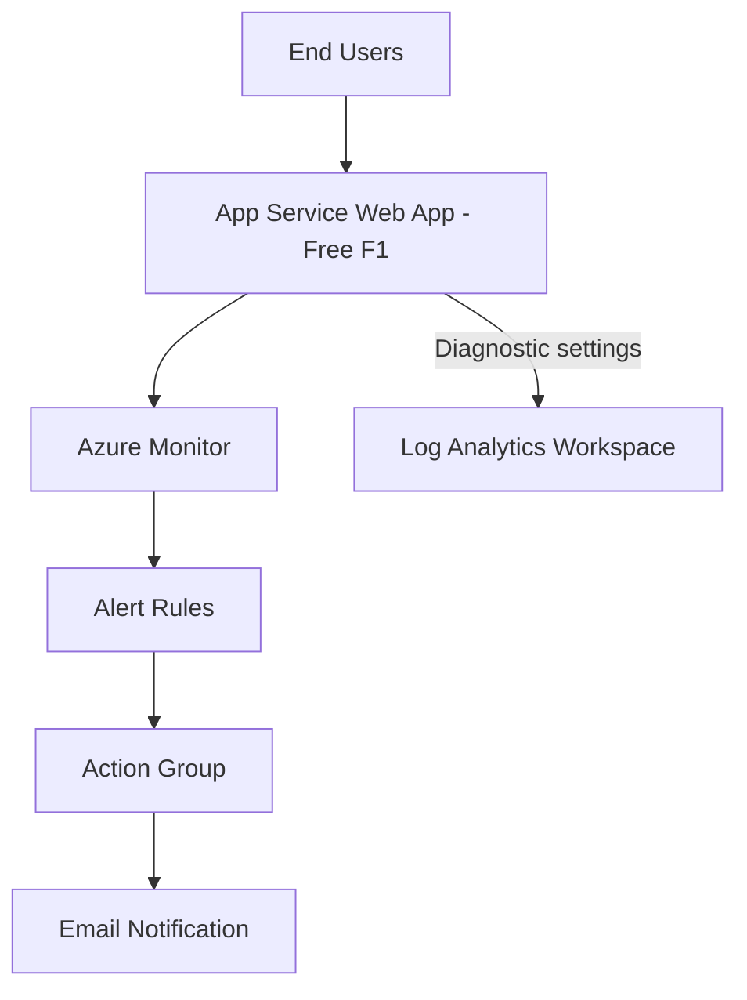

# Basic Web App Monitoring on Azure with App Service and Azure Monitor

## Project Overview

This project deploys a small web application to **Azure App Service** and builds a basic monitoring setup around it using **Azure Monitor** and **Log Analytics**. The goal is to detect slow responses and server errors before users notice them.

I built everything manually through the **Azure Portal** to learn how each service fits together and what each setting does. The lab is based on the [Basic Web App Monitoring recipe](https://github.com/mzazon/cloud-projects/blob/main/azure/basic-web-monitoring-app-service-monitor/basic-web-monitoring-app-service-monitor.md) by mzazon, which uses the Azure CLI. I followed the same design but used the portal instead.


<!-- Add your own screenshot or diagram to /images, or use the Mermaid diagram below -->



## Features

- Web app hosted on Azure App Service using the **Free (F1)** tier.
- Application logging enabled on the App Service file system.
- **Diagnostic settings** route HTTP, console and application logs plus metrics to a Log Analytics workspace.
- Two **static metric alert rules**:
  - High response time: average response time greater than 5 seconds.
  - HTTP 5xx errors: more than 10 server errors within 5 minutes.
- An **action group** that emails me when an alert fires.
- Logs queried with **KQL** in Log Analytics.
- Built for near-zero cost, with a full cleanup at the end.

## Technologies Used

- Azure App Service (Free F1 plan)
- Azure Monitor (metrics and alert rules)
- Log Analytics Workspace
- Diagnostic Settings
- Action Groups
- Kusto Query Language (KQL)
- Azure Portal

## Getting Started

### Prerequisites

- An active Azure subscription with Contributor access.
- A basic understanding of web apps and HTTP status codes.
- An email address for alert notifications.
- Free F1 quota in the region you choose (see [Lessons Learned](#lessons-learned--challenges-overcome)).

## Deployment Steps

### Step 1: Create a Resource Group

1. Open **Resource groups** and select **Create**.
2. Name it `rg-webmonitor-lab` and choose a region.
3. Select **Review + create**, then **Create**.

### Step 2: Create the Web App on the Free Plan

1. Open **App Services** and select **Create** > **Web App**.
2. Choose the resource group and enter a globally unique name.
3. Publish as **Code**, runtime stack **Node (LTS)**, operating system **Linux**.
4. Under **Pricing plans**, choose **Free F1**.
5. Leave Application Insights off to keep the lab simple.
6. Select **Review + create**, then **Create**.
7. Open the default domain URL to confirm the app loads.

### Step 3: Create the Log Analytics Workspace

1. Open **Log Analytics workspaces** and select **Create**.
2. Use the same resource group and region as the web app.
3. Name it `logs-webmonitor-lab`, then **Review + create**.

### Step 4: Enable Application Logging

1. Open the web app, then **Monitoring** > **App Service logs**.
2. Set **Application logging** to **File System**.
3. Leave the quota at 35 MB and set **Retention Period** to 3 days.
4. Select **Save**.

### Step 5: Configure Diagnostic Settings

1. Open **Monitoring** > **Diagnostic settings** > **Add diagnostic setting**.
2. Name it `AppServiceDiagnostics`.
3. Select the HTTP, Console and Application log categories and **AllMetrics**.
4. Choose **Send to Log Analytics workspace** and select `logs-webmonitor-lab`.
5. Select **Save**.

### Step 6: Create the Action Group

1. Open **Monitor** > **Alerts** > **Action groups** > **Create**.
2. Name it `WebAppAlerts` with the display name `WebAlert`.
3. On the **Notifications** tab, add an **Email** notification with my email address.
4. Select **Review + create**, then **Create**.

### Step 7: Create the Response Time Alert

1. Open the web app, then **Monitoring** > **Alerts** > **Create** > **Alert rule**.
2. Select the **Response Time** signal.
3. Set **Threshold type** to **Static**, aggregation **Average**, operator **Greater than**, value **5** seconds.
4. Check every 1 minute with a 5 minute lookback.
5. Attach the `WebAppAlerts` action group.
6. Set severity to **2 - Warning** and name it `HighResponseTime`.

### Step 8: Create the HTTP 5xx Alert

1. Create another alert rule using the **Http Server Errors** signal.
2. Set **Threshold type** to **Static**, aggregation **Total**, operator **Greater than**, value **10**.
3. Check every 1 minute with a 5 minute lookback.
4. Attach the `WebAppAlerts` action group.
5. Set severity to **1 - Error** and name it `HTTP5xxErrors`.

### Step 9: Validate

- Browse to the web app several times to generate traffic.
- Open **Log stream** to watch live logs.
- Confirm both alert rules show as **Enabled**.
- After 5 to 15 minutes, run this query in the Log Analytics workspace:

```kusto
AppServiceHTTPLogs
| where TimeGenerated > ago(1h)
| take 10
```

### Step 10: Clean Up

1. Open **Resource groups** and select `rg-webmonitor-lab`.
2. Select **Delete resource group** and confirm the name.
3. Check for any leftover resources from failed attempts and delete them too.

## Screenshots

<!-- Save your screenshots in an /images folder and update the file names below -->

| Evidence | Screenshot |
| --- | --- |
| Web app running |  |
| App Service logs configuration |  |
| Diagnostic settings |  |
| Alert rules list (both Enabled) |  |
| KQL query results |  |

## Usage

- This setup is a starting template for monitoring any App Service web app.
- Platform metrics such as response time and server errors need no code changes.
- Log Analytics gives a central place to search logs across resources with KQL.
- The same action group can be reused for other alert rules.

## Cost

The project is designed to cost close to nothing:

| Resource | Cost |
| --- | --- |
| App Service plan (Free F1) | $0 |
| Platform metrics | Free |
| Log Analytics | First 5 GB/month free, then about $2.30/GB |
| Metric alerts | First 10 monitored time series free |

I deleted the resource group after finishing so nothing keeps billing.

## Lessons Learned & Challenges Overcome

- **Free tier quota error.** My first deployment failed with "Operation cannot be completed without additional quota" because the Free (F1) quota in that region was 0. Quota is set per region and subscription, so I had to choose a different region (or request quota).
  <!-- Add which region or fix you used -->
- **Static vs Dynamic thresholds.** The alert rule form defaults to a Dynamic threshold, which learns normal behaviour and has no fixed value. This lab needs a fixed limit, so I switched the threshold type to **Static**.
- **Portal vs CLI differences.** The portal labels and layout differ from the CLI commands in the original recipe. Some options, such as a separate web server logging toggle, were not shown for my app.
- **Metrics vs logs vs alerts.** Metrics tell you something is wrong, logs help you find out why, and alerts tell you when to look.
- **Cleanup matters.** Deleting the resource group removes everything in one step and avoids surprise charges.

## Future Enhancements

- Add **Application Insights** for request tracing, failures and dependency tracking.
- Write custom **KQL queries** to find error patterns.
- Build an **Azure Workbook** dashboard for key metrics.
- Add **availability tests** to check the app from multiple locations.
- Add **autoscaling** rules (needs a paid plan).
- Rebuild the whole project with **Bicep or Terraform** so it is repeatable and version controlled.

## Credits

Based on the [Basic Web App Monitoring with App Service and Azure Monitor](https://github.com/mzazon/cloud-projects/blob/main/azure/basic-web-monitoring-app-service-monitor/basic-web-monitoring-app-service-monitor.md) recipe from [mzazon/cloud-projects](https://github.com/mzazon/cloud-projects). The deployment here was done manually in the Azure Portal.
