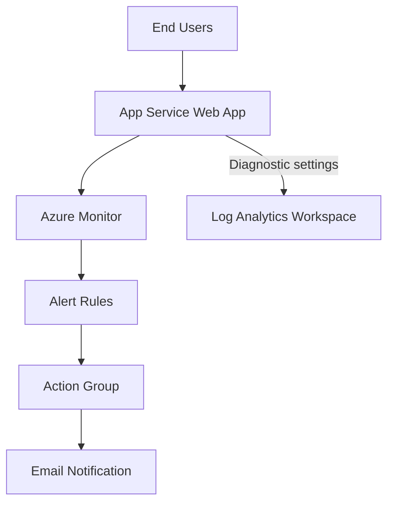

# Web App Monitoring on Azure with App Service and Azure Monitor


### The Problem

A small business runs a customer-facing web application, but it has **no monitoring** in place. The team only finds out about problems when customers complain or when someone happens to notice.

- Slow page loads go unnoticed until customers give up and leave.
- Server errors (HTTP 5xx) can go on for hours with nobody aware.
- Logs are scattered across the app and are hard to search when something breaks.
- Troubleshooting is slow because there is no history to look back on.
- There is no alerting, so the team reacts to problems instead of preventing them.

### The Solution

Set up a lightweight monitoring and alerting pipeline on Azure so the team is told about problems **before customers notice them**.

| Problem | Solution in this project |
| --- | --- |
| No visibility into app health | **Azure Monitor** collects platform metrics such as response time and server errors |
| Logs are hard to find | **Diagnostic settings** send logs to a central **Log Analytics workspace** |
| Hard to investigate issues | Logs are searchable with **KQL** queries |
| Problems found too late | **Alert rules** fire when response time or 5xx errors cross a threshold |
| Nobody gets notified | An **action group** emails the team as soon as an alert fires |

### The Outcome

- Slow responses (average over 5 seconds) trigger a warning alert.
- Bursts of server errors (more than 10 in 5 minutes) trigger an error alert.
- Logs are stored centrally and can be queried when investigating an incident.

## Project Overview

This project deploys a small web application to **Azure App Service** and builds a basic monitoring setup around it using **Azure Monitor** and **Log Analytics**. The goal is to detect slow responses and server errors before users notice them.




## Features

- Web app hosted on Azure App Service.
- Application logging enabled on the App Service file system.
- **Diagnostic settings** route HTTP, console and application logs plus metrics to a Log Analytics workspace.
- Two **static metric alert rules**:
  - High response time: average response time greater than 5 seconds.
  - HTTP 5xx errors: more than 10 server errors within 5 minutes.
- An **action group** that emails me when an alert fires.
- Logs queried with **KQL** in Log Analytics.


## Technologies Used

- Azure App Service 
- Azure Monitor (metrics and alert rules)
- Log Analytics Workspace
- Diagnostic Settings
- Action Groups
- Kusto Query Language (KQL)
- Azure Portal

## Getting Started

### Prerequisites

- An active Azure subscription with Contributor access.
- A basic understanding of web apps and HTTP status codes.
- An email address for alert notifications.


## Deployment Steps

### Step 1: Create a Resource Group

1. Open **Resource groups** and select **Create**.
2. Name it `rg-webmonitor-lab` and choose a region.
3. Select **Review + create**, then **Create**.

### Step 2: Create the Web App

1. Open **App Services** and select **Create** > **Web App**.
2. Choose the resource group and enter a globally unique name.
3. Publish as **Code**, runtime stack **Node (LTS)**, operating system **Linux**.
4. Under **Pricing plans**, choose **Free F1**.
5. Leave Application Insights off to keep the lab simple.
6. Select **Review + create**, then **Create**.
7. Open the default domain URL to confirm the app loads.

### Step 3: Create the Log Analytics Workspace

1. Open **Log Analytics workspaces** and select **Create**.
2. Use the same resource group and region as the web app.
3. Name it `logs-webmonitor-lab`, then **Review + create**.

### Step 4: Enable Application Logging

1. Open the web app, then **Monitoring** > **App Service logs**.
2. Set **Application logging** to **File System**.
3. Leave the quota at 35 MB and set **Retention Period** to 3 days.
4. Select **Save**.

### Step 5: Configure Diagnostic Settings

1. Open **Monitoring** > **Diagnostic settings** > **Add diagnostic setting**.
2. Name it `AppServiceDiagnostics`.
3. Select the HTTP, Console and Application log categories and **AllMetrics**.
4. Choose **Send to Log Analytics workspace** and select `logs-webmonitor-lab`.
5. Select **Save**.

### Step 6: Create the Action Group

1. Open **Monitor** > **Alerts** > **Action groups** > **Create**.
2. Name it `WebAppAlerts` with the display name `WebAlert`.
3. On the **Notifications** tab, add an **Email** notification with my email address.
4. Select **Review + create**, then **Create**.

### Step 7: Create the Response Time Alert

1. Open the web app, then **Monitoring** > **Alerts** > **Create** > **Alert rule**.
2. Select the **Response Time** signal.
3. Set **Threshold type** to **Static**, aggregation **Average**, operator **Greater than**, value **5** seconds.
4. Check every 1 minute with a 5 minute lookback.
5. Attach the `WebAppAlerts` action group.
6. Set severity to **2 - Warning** and name it `HighResponseTime`.

### Step 8: Create the HTTP 5xx Alert

1. Create another alert rule using the **Http Server Errors** signal.
2. Set **Threshold type** to **Static**, aggregation **Total**, operator **Greater than**, value **10**.
3. Check every 1 minute with a 5 minute lookback.
4. Attach the `WebAppAlerts` action group.
5. Set severity to **1 - Error** and name it `HTTP5xxErrors`.

### Step 9: Validate

- Browse to the web app several times to generate traffic.
- Open **Log stream** to watch live logs.
- Confirm both alert rules show as **Enabled**.
- After 5 to 15 minutes, run this query in the Log Analytics workspace:

```kusto
AppServiceHTTPLogs
| where TimeGenerated > ago(1h)
| take 10
```

### Step 10: Clean Up

1. Open **Resource groups** and select `rg-webmonitor-lab`.
2. Select **Delete resource group** and confirm the name.
3. Check for any leftover resources from failed attempts and delete them too.


## Usage

- This setup is a starting template for monitoring any App Service web app.
- Platform metrics such as response time and server errors need no code changes.
- Log Analytics gives a central place to search logs across resources with KQL.
- The same action group can be reused for other alert rules.


## Future Enhancements

- Add **Application Insights** for request tracing, failures and dependency tracking.
- Write custom **KQL queries** to find error patterns.
- Build an **Azure Workbook** dashboard for key metrics.
- Add **availability tests** to check the app from multiple locations.
- Add **autoscaling** rules.
- Rebuild the whole project with **Bicep or Terraform** so it is repeatable and version controlled.

